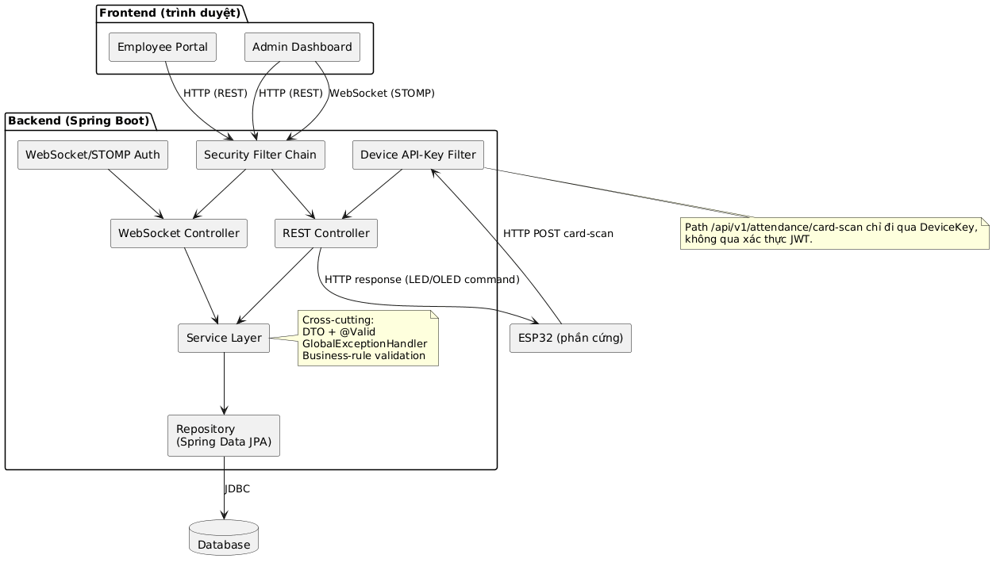

# TapTrack — Hệ thống chấm công bằng thẻ từ (ESP32 + Spring Boot)

TapTrack là hệ thống chấm công nhân viên theo ca làm việc. Nhân viên quẹt thẻ RFID tại thiết bị ESP32; Backend Spring Boot xác thực thiết bị, đối chiếu ca được phân công, xác định vào ca/ra ca, phân loại trạng thái (đúng giờ, trễ, về sớm) rồi trả kết quả để ESP32 hiển thị trên OLED và LED xanh/đỏ. Admin theo dõi và quản lý qua REST API (kèm WebSocket cho dữ liệu thời gian thực).

> Đồ án PBL5 — *Thiết kế và xây dựng hệ thống chấm công ứng dụng ESP32 và Spring Boot.*

## Mục lục

- [Tính năng](#tính-năng)
- [Kiến trúc](#kiến-trúc)
- [Công nghệ](#công-nghệ)
- [Cấu trúc thư mục](#cấu-trúc-thư-mục)
- [Cài đặt Backend](#cài-đặt-backend)
- [Cài đặt Firmware ESP32](#cài-đặt-firmware-esp32)
- [API chính](#api-chính)
- [Bảo mật](#bảo-mật)
- [Tài liệu](#tài-liệu)
- [Tiến độ](#tiến-độ)

## Tính năng

- **Chấm công qua thẻ từ:** ESP32 gửi mã thẻ, Backend tự xác định vào ca/ra ca. Mỗi nhân viên tối đa 1 lượt vào và 1 lượt ra mỗi ngày.
- **Phân loại trạng thái độc lập:** `checkInStatus` (đúng giờ/trễ, theo grace period) và `checkOutStatus` (đúng giờ/về sớm); trạng thái *Vắng* và *Thiếu check-out* được suy luận, không lưu DB.
- **Chống race condition:** hai lần quẹt gần như đồng thời được chặn bởi ràng buộc `UNIQUE(employeeId, workDate)` và transaction (trả `409 SCAN_CONFLICT`).
- **Quản lý:** phòng ban, nhân viên (ACTIVE/INACTIVE, không xóa cứng), mẫu ca và phân ca, tài khoản Admin/Employee.
- **Admin:** dashboard hôm nay, báo cáo tháng, danh sách vắng, sửa/bổ sung chấm công thủ công (lưu người sửa, thời điểm, lý do), xem thẻ lạ gần nhất để cấp thẻ.
- **Nhân viên:** xem lịch sử chấm công và lịch phân ca theo tuần của chính mình.
- **Thời gian thực:** đẩy lượt chấm công mới đến Admin qua WebSocket/STOMP (`/topic/attendance`).
- **Phản hồi trên thiết bị:** OLED hiển thị họ tên/giờ/trạng thái hoặc lý do từ chối (không dấu); LED xanh khi hợp lệ, đỏ khi lỗi.

## Kiến trúc



- **Thiết bị:** ESP32 gọi `POST /api/v1/attendance/card-scan` kèm header `X-Device-API-Key` (không dùng JWT).
- **Người dùng:** đăng nhập một cổng chung bằng email/mật khẩu, nhận một Access Token JWT; phân quyền `ADMIN` / `EMPLOYEE`.
- **Backend:** phân lớp `controller → service → repository`, DTO + `@Valid`, xử lý lỗi tập trung (`GlobalExceptionHandler`), mọi response REST bọc trong `ApiResponse` (riêng `CardScanResponse` trả thẳng cho ESP32).
- **Thời gian:** do server sinh, múi giờ `Asia/Ho_Chi_Minh`.

Các sơ đồ khác: [Use Case](docs/UseCase.png) · [ERD](docs/ERD.png) · [Sequence card-scan](docs/Sequence.png).

## Công nghệ

| Thành phần | Công nghệ |
|---|---|
| Backend | Java 21, Spring Boot 3.3.4, Spring Web, Spring Data JPA, Spring Validation |
| Bảo mật | Spring Security, JWT (jjwt 0.12.6), BCrypt, Device API Key |
| Realtime | Spring WebSocket (STOMP, SockJS) |
| Cơ sở dữ liệu | PostgreSQL (H2 cho test) |
| Tài liệu API | springdoc-openapi (Swagger UI) |
| Build | Gradle (wrapper kèm theo), Lombok |
| Firmware | ESP32, Arduino framework (C++) |
| Phần cứng | ESP32, RFID RC522 (SPI), OLED SSD1306 128x64 (I2C), 2 LED |

## Cấu trúc thư mục

```
taptrack-attendance-system/
├── src/main/java/com/taptrack/   # Backend: config, controller, dto, entity, enums,
│                                 #   exception, mapper, repository, security, service, util
├── src/main/resources/           # application*.properties, logback-spring.xml
├── firmware/taptrack_esp32/      # Firmware Arduino cho ESP32
├── docs/                         # SRS, cấu trúc Backend/ESP32/Frontend, sơ đồ
├── build.gradle
└── gradlew / gradlew.bat
```

## Cài đặt Backend

### Yêu cầu

- JDK 21
- PostgreSQL (đã tạo sẵn một database, ví dụ `taptrack_db`)

### Cấu hình

`application.properties` mặc định dùng profile `local`. File `application-local.properties` chứa thông tin riêng và **không được commit** (đã có trong `.gitignore`), nên bạn cần tự tạo `src/main/resources/application-local.properties`:

```properties
spring.datasource.url=jdbc:postgresql://localhost:5432/taptrack_db
spring.datasource.username=postgres
spring.datasource.password=<mật-khẩu-DB>
spring.datasource.driver-class-name=org.postgresql.Driver
```

Các biến cấu hình quan trọng:

| Thuộc tính | Biến môi trường | Mô tả |
|---|---|---|
| `app.jwt.secret` | `JWT_SECRET` | Khóa ký JWT, tối thiểu 32 byte |
| `app.jwt.access-token-ttl-seconds` | — | Thời hạn token (mặc định 28800 = 8 giờ) |
| `app.device.api-key` | — | Khóa thiết bị; **phải khớp** `DEVICE_API_KEY` trong `secrets.h` của firmware |
| `attendance.grace-period-minutes` | — | Số phút cho phép trễ (mặc định 5) |
| `app.seed.enabled` | — | `true` để nạp dữ liệu mẫu khi khởi động |

Profile `prod` (`application-prod.properties`) đọc `DB_URL`, `DB_USERNAME`, `DB_PASSWORD` từ biến môi trường và dùng `ddl-auto=validate`.

### Chạy

```bash
# Linux/macOS
./gradlew bootRun

# Windows
gradlew.bat bootRun
```

Ứng dụng chạy tại `http://localhost:8080`. Swagger UI: `http://localhost:8080/swagger-ui.html`.

Chạy test: `./gradlew test`.

### Dữ liệu mẫu

Khi `app.seed.enabled=true`, hệ thống nạp 3 phòng ban (Backend, Frontend, QA), 3 tài khoản nhân viên mẫu (`nv01@taptrack.local`, `nv02@taptrack.local`, `nv03@taptrack.local`, mật khẩu mặc định `Employee@123`) và hồ sơ nhân viên tương ứng. **Chỉ dùng cho phát triển, hãy tắt khi triển khai thật.**

Tài khoản Admin đầu tiên cần được tạo thủ công trong cơ sở dữ liệu (role `ADMIN`, mật khẩu băm BCrypt); các Admin tiếp theo tạo qua `POST /api/v1/admin/accounts`.

## Cài đặt Firmware ESP32

### Đấu nối (theo `config.h`)

| Thiết bị | Chân thiết bị | GPIO ESP32 |
|---|---|---|
| OLED SSD1306 (I2C, địa chỉ `0x3C`) | SDA / SCL | 21 / 22 |
| RFID RC522 (SPI) | SS / RST | 16 / 17 |
| | SCK / MISO / MOSI | 18 / 19 / 23 |
| LED xanh | Anode (qua điện trở) | 12 |
| LED đỏ | Anode (qua điện trở) | 13 |

### Thư viện (Arduino Library Manager)

`MFRC522`, `ArduinoJson`, `Adafruit GFX Library`, `Adafruit SSD1306`; `WiFi` và `HTTPClient` có sẵn khi cài board ESP32.

### Cấu hình và nạp code

1. Mở `firmware/taptrack_esp32/taptrack_esp32.ino` bằng Arduino IDE, chọn board ESP32.
2. Sửa `secrets.h` (WiFi SSID, mật khẩu WiFi, `DEVICE_API_KEY` khớp với `app.device.api-key` của Backend). **Không commit thông tin thật.**
3. Sửa `BACKEND_BASE_URL` trong `config.h` thành IPv4 của máy chạy Backend trong mạng LAN, ví dụ `http://192.168.2.11:8080` (xem bằng `ipconfig` / `ip addr`).
4. ESP32 và máy chạy Backend phải cùng mạng WiFi/LAN; mở cổng 8080 trên firewall nếu ESP32 không kết nối được.
5. Nạp code và mở Serial Monitor (115200 baud).

### Luồng hoạt động

Khởi động → kết nối WiFi → chờ thẻ → đọc và chuẩn hóa mã thẻ → `POST /api/v1/attendance/card-scan` → parse JSON phản hồi → bật LED xanh/đỏ và hiển thị OLED → về màn hình chờ. ESP32 không tự sinh thời gian chấm công, `scanTime` hiển thị lấy từ phản hồi của Backend.

## API chính

Mọi endpoint nằm dưới `/api/v1`. Tài liệu đầy đủ trên Swagger UI.

| Nhóm | Phương thức & đường dẫn | Quyền |
|---|---|---|
| Thiết bị | `POST /attendance/card-scan` | `X-Device-API-Key` |
| Xác thực | `POST /auth/login` | Công khai |
| | `POST /auth/change-password` | Đã đăng nhập |
| Phòng ban | `GET/POST /admin/departments`, `PUT/DELETE /admin/departments/{id}` | Admin |
| Tài khoản | `POST /admin/accounts`, `POST /admin/accounts/{id}/reset-password` | Admin |
| Nhân viên | `GET /admin/employees`, `GET/PUT /admin/employees/{id}`, `GET /admin/employees/{id}/schedule/week` | Admin |
| Ca làm việc | `POST/GET /admin/shift-templates`, `DELETE /admin/shift-templates/{id}`, `POST /admin/shift-assignments`, `PUT/DELETE /admin/shift-assignments/{id}` | Admin |
| Chấm công | `GET /admin/attendance`, `POST /admin/attendance/manual-edit`, `GET /admin/attendance/unknown-cards` | Admin |
| Dashboard, báo cáo | `GET /admin/dashboard/today`, `GET /admin/reports/monthly`, `GET /admin/reports/absent-today` | Admin |
| Nhân viên | `GET /employee/my-attendance`, `GET /employee/my-schedule/week` | Employee |
| Realtime | WebSocket `/ws` (SockJS/STOMP), subscribe `/topic/attendance` | Admin (JWT) |

### Ví dụ chấm công

```http
POST /api/v1/attendance/card-scan
X-Device-API-Key: <DEVICE_API_KEY>
Content-Type: application/json

{ "cardCode": "04A1B2C3" }
```

Thành công trả `200` với `CardScanResponse` (`employeeName`, `scanTime`, `attendanceType` = `CHECK_IN`/`CHECK_OUT`, `checkInStatus`, `checkOutStatus`, `ledCommand`, `oledMessage`). Các lỗi nghiệp vụ gồm `UNKNOWN_CARD`, `EMPLOYEE_INACTIVE`, `NO_SHIFT_TODAY`, `SCAN_CONFLICT`, `ATTENDANCE_ALREADY_COMPLETE`.

## Bảo mật

- Mật khẩu băm BCrypt; JWT stateless (một Access Token, không có Refresh Token).
- Đăng nhập thất bại luôn trả `INVALID_CREDENTIALS` (401) để không lộ email có tồn tại.
- Device API Key so sánh thời gian hằng số (`MessageDigest.isEqual`).
- WebSocket chỉ cho Admin đã xác thực JWT.
- **Không đưa secret thật lên Git:** WiFi, `DEVICE_API_KEY`, `JWT_SECRET`, mật khẩu DB.

## Tài liệu

- [SRS — Đặc tả yêu cầu](docs/SRS.md)
- [Cấu trúc Backend](docs/Backend_Structure.md)
- [Cấu trúc Firmware ESP32](docs/ESP32_Structure.md)
- [Cấu trúc Frontend](docs/Frontend_Structure.md)

## Tiến độ

- [x] Đặc tả yêu cầu, use case, kiến trúc, ERD, sequence
- [x] Firmware ESP32: WiFi, RC522, OLED, LED, gọi API card-scan
- [x] Backend: xác thực JWT, Device API Key, card-scan, quản lý phòng ban/nhân viên/ca, báo cáo, WebSocket
- [ ] Frontend web (Admin Dashboard, Employee Portal)
- [ ] Kiểm thử tự động và kiểm thử toàn diện
- [ ] Mở rộng: xuất Excel, nhiều thiết bị, audit log

## Giấy phép

Dự án phục vụ học tập (đồ án PBL5), chưa khai báo giấy phép.
